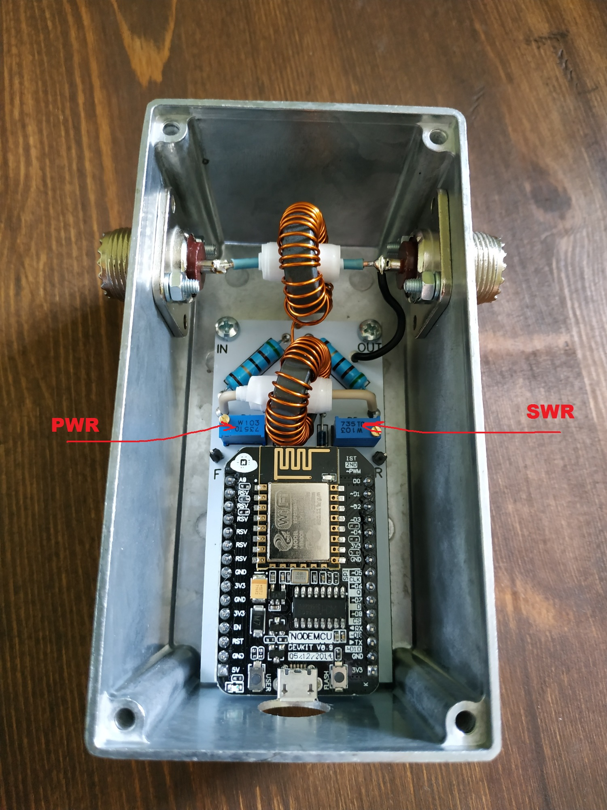
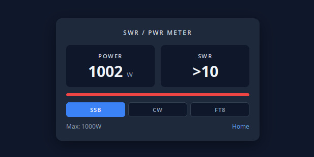
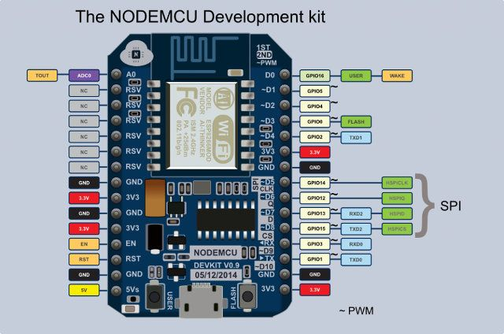
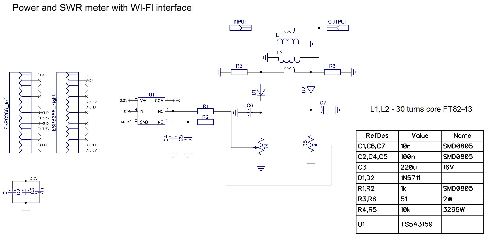

# SWR_PWR_meter

SWR and power meter with Wi-Fi interface based on ESP8266 (NodeMCU 0.9).

More information (in Russian): https://ra0sms.com/swr_power_meter/




## Features

- Measures **forward power (PEP)** and **SWR** in real time
- Web interface with smooth power bar, peak marker and SWR display
- Captive portal for easy first-time Wi-Fi setup
- Saves Wi-Fi credentials to EEPROM (survives reboot)
- Automatic fallback to SoftAP mode when the network is lost
- Automatic reconnect to the saved network
- Configurable power range: 200 / 300 / 1000 / 2000 W
- Peak-hold (PEP) sampling on the device, display ballistics with SSB / CW / FT8 mode selector
- Optional HTTP Basic Auth for all web pages

## Specifications

| Parameter | Value |
|---|---|
| Power supply | microUSB 5V 1A |
| Full-scale power | 1 – 1000 W (configurable up to 2000 W) |
| Frequency range | 1 – 30 MHz |
| Measurement | PEP (Peak Envelope Power) |
| Wi-Fi range | up to 50 m (entry-level router) |
| Housing | Gainta G0479 |
| Board | NodeMCU 0.9 (ESP8266) |

## Hardware

**Make sure you use the ESP8266 board v 0.9. Check the pinout!**





### Pin usage

| Pin | NodeMCU | Function |
|---|---|---|
| `A0` | A0 | ADC input (forward/reflected detector) |
| `switch_pin` (5) | D1 | Analog switch control (forward/reflected) |
| `led_pin` (16) | D0 | Status LED (on = not connected, off = connected) |

Gerber files for the PCB: [SWR_gerber.zip](gerber/SWR_gerber.zip)

## Building and flashing

1. Install [Arduino IDE](https://www.arduino.cc/en/software) (or use `arduino-cli`).
2. Add the ESP8266 board manager URL: `http://arduino.esp8266.com/stable/package_esp8266com_index.json`
3. Install the **esp8266** core (tested with 3.1.2).
4. Select board **NodeMCU 0.9 (ESP8266-12E)**.
5. Open [`src/swr_source/swr_source.ino`](src/swr_source/swr_source.ino) and upload.

Required libraries (installed with the core by default):

- `ESP8266WiFi`
- `ESP8266WebServer`
- `DNSServer`
- `EEPROM`

## Ready firmware

Pre-built binaries for **NodeMCU 0.9 (ESP8266-12E)** (core 3.1.2):

| File | MAX_POWER | Authentication | Size |
|---|---|---|---|
| [`firmware/swr_source_auth.bin`](firmware/swr_source_auth.bin) | 1000 W | Enabled (`admin` / `swr12345`) | 330 KB |
| [`firmware/swr_source_noauth.bin`](firmware/swr_source_noauth.bin) | 1000 W | Disabled | 326 KB |
| [`firmware/swr_source_noauth_2000W.bin`](firmware/swr_source_noauth_2000W.bin) | 2000 W | Disabled | 326 KB |

Flash at address `0x00000` using esptool, Arduino IDE or NodeMCU PyFlasher.

## Configuration

### Power range

Set `MAX_POWER` in [`swr_source.ino`](src/swr_source/swr_source.ino) to one of: `200`, `300`, `1000`, `2000` (other values fail to compile).

### Calibration

The power formula is `P = (U + DIODE_OFFSET)² / K` (`U` in ADC counts), where `K` depends on the power range:

| MAX_POWER | K |
|---|---|
| 200 W | 5230 |
| 300 W | 3487 |
| 1000 W | 1046 |
| 2000 W | 523 |

Adjust `POWER_K` at the top of the sketch to match your hardware (detector sensitivity, ADC divider).

`DIODE_OFFSET` compensates the detector diode drop (1N5711 ≈ 0.2–0.3 V ≈ 60–90 ADC counts), which makes
the pure `U²/K` formula read low at small power. The default `0` keeps the classic calibration; if you set
it, recalibrate `POWER_K` at the top of the range.

Other measurement constants:

| Constant | Default | Meaning |
|---|---|---|
| `FWD_MIN` | 50 | Forward level (ADC counts) below which power reads 0 |
| `SWR_MIN_FWD` | 100 | SWR is calculated only above this forward level |
| `PEAK_BIN_MS` | 100 | Peak-hold window; the reading is the maximum over the last 100–200 ms |

### SoftAP credentials

The access point SSID is built automatically from the ESP8266 chip ID: `SWRmeter_XXXXXX`, where
`XXXXXX` is the chip ID in hex (the last 3 bytes of the MAC address). Every device gets a unique name
from the same firmware, so nothing needs to be edited per device. The SSID is also printed to the serial
port at boot (115200 baud).

The prefix and the password are defined at the top of the sketch:

```cpp
const char *softAP_prefix = "SWRmeter_";
const char *softAP_password = "1234567890";
```

Change them before flashing if needed.

### Authentication

All web pages can be protected with HTTP Basic Auth. Credentials and the enable flag are defined at the top of the sketch:

```cpp
const bool AUTH_ENABLED = false;  // Set to true to enable authentication
const char *auth_user = "admin";
const char *auth_pass = "swr12345";
```

- Set `AUTH_ENABLED = true` to protect all web pages with a login/password prompt.
- Change `auth_user` / `auth_pass` before flashing if needed.
- The browser asks for credentials once; subsequent `/xml` and `/mode` requests are authenticated automatically.

### How the power reading works

The detector follows the RF envelope (time constant ~1 ms), so in SSB/CW the voltage changes with every
syllable and dot. The device samples forward/reflected voltage in close pairs (~0.2 ms apart) several
hundred times per second and keeps the **maximum** over a 100–200 ms window (PEP). SWR is taken from the
pair measured at that peak, so forward and reflected values belong to the same moment.

### Display ballistics (SSB / CW / FT8)

The `/swr` page has a **SSB / CW / FT8** mode selector. The browser renders at the display frame rate
(independent of network timing) with fast attack, hold and slow release, like a peak-reading meter.
When the carrier disappears, the reading falls to zero quickly (drop time constant 0.08 s) instead of
creeping down along the release curve.
Settings are in the `MODES` table of the page script:

| Mode | Attack | Hold | Release | Use case |
|---|---|---|---|---|
| SSB | 0.03 s | 700 ms | 0.6 s | Readable PEP through speech |
| CW | 0.03 s | 300 ms | 0.3 s | Bridges gaps between dots/dashes |
| FT8 | 0.05 s | 0 | 0.3 s | Constant carrier: fast rise, light smoothing |

Also:

- The white marker on the bar shows the peak of the last 2 s and goes to zero together with the reading after TX ends.
- Numbers update 5 times per second; above 100 W the value is rounded to 5 W (above 1000 W — to 10 W).
- SWR keeps its last value for 3 s during pauses instead of jumping to `---`.
- If the device stops answering for 2 s, the values dim and the power falls to 0.

The selected mode is kept in RAM only and resets to **SSB** after reboot (no flash wear).

## First-time setup (Wi-Fi)

1. Power the device via microUSB (5V 1A). Your router must have **DHCP enabled**.
2. On your phone/computer, connect to the Wi-Fi network **`SWRmeter_XXXXXX`** (unique per device, password `1234567890`).
3. Open `http://192.168.4.1/wifi` in a browser.
4. Enter your network name and password, click **Connect**.
5. The device connects to your network, the SoftAP turns off automatically, and the device gets an IP from your router. Use that IP to access the web interface.

> If the connection is lost later, the device automatically re-enables the SoftAP and keeps retrying the saved network every 30 seconds. Automatic retries are non-blocking, so the web server and captive portal stay responsive. Only the first connect (at boot or after saving credentials) waits up to 10 s for the result.

## Web interface

| URL | Description |
|---|---|
| `/` | Start page with connection info |
| `/wifi` | Wi-Fi configuration (network scan, connect form) |
| `/swr` | SWR / power meter page (with SSB/CW/FT8 mode selector) |
| `/data` | JSON data endpoint `{"p":123,"s":"1.35"}` — used by the meter page |
| `/xml` | Legacy XML endpoint (`<pwr>`, `<swr>`, `<adcpower>`) for external integrations |
| `/mode?m=ssb\|cw\|ft8` | Set display smoothing mode (used by the mode selector) |

All pages require authentication (if `AUTH_ENABLED = true`). The `/data` and `/xml` endpoints can be used to integrate readings into other systems (e.g., home automation). Both return the peak (PEP) of the last 100–200 ms; `s` / `<swr>` is empty when the power is too low for a meaningful SWR.

## Changelog

- **2019** — First version
- **2021-03-12** — Added selectable max power (2000/1000/200 W) via `#define`
- **2025-05-22** — New CSS-based web interface
- **2026-06-24** — Code cleanup: removed unused vars/includes, `constexpr`, `millis()` timer
- **2026-10-13** — Reliability & security improvements:
  - Reconnect on connection loss (`WL_CONNECTION_LOST` / `WL_DISCONNECTED`)
  - `no-cache` headers for `/xml` and `/swr`
  - SWR clamped at low power, fixed unsigned underflow in SWR calculation
  - Removed dead code, merged `flagOn`/`isWiFiConnected`
  - Larger SSID/password buffers (32/63 chars), input validation with error display
  - Compact dark redesign of the `/swr` page
  - SSB/CW/FT8 display smoothing mode selector (RAM only, no flash wear)
  - HTTP Basic Auth for all web pages (`AUTH_ENABLED` flag, configurable login/password)
- **2026-10-14** — Wi-Fi fixes:
  - Restored blocking `waitForConnectResult()` in `connectWifi()` — fixes first-connect failure (`WL_WRONG_PASSWORD`) after entering credentials
  - Retry interval 30 s, no retries on wrong password
- **2026-10-15** — Smooth power display in SSB/CW and other improvements:
  - Peak-hold (PEP) sampling on the device: maximum over a 100–200 ms window instead of the last sample
  - Forward/reflected measured in close pairs, SWR taken at the envelope peak
  - Browser ballistics with attack/hold/release per mode, rendering via `requestAnimationFrame`, peak marker on the bar
  - Sequential polling of the new `/data` JSON endpoint (no overlapping requests), stale-data indication
  - Wi-Fi modem sleep disabled (removes 100–300 ms random response latency)
  - Non-blocking automatic reconnect retries; `millis()` overflow-safe timers
  - HTML escaping of SSIDs (XSS from a malicious nearby access point)
  - Pages streamed from PROGMEM in chunks instead of large `String`s
  - `DIODE_OFFSET` calibration constant, `static_assert` for `MAX_POWER`
  - Pre-built 2000 W firmware
- **2026-10-16** — SoftAP SSID built from the chip ID (`SWRmeter_XXXXXX`), no per-device edits needed
- **2026-10-16** — Faster display response:
  - Power reading falls to zero quickly after TX ends in all modes (fast drop + snap to 0), peak marker follows
  - Shorter hold/release in SSB and CW
  - Fast rise in FT8 mode (attack 0.3 s → 0.05 s)
  - Rebuilt pre-built firmware

> **Note:** the buffer size change shifts the EEPROM layout — saved Wi-Fi credentials are cleared once after this update. Re-enter them via the web interface.

## License

See [LICENSE](LICENSE).
